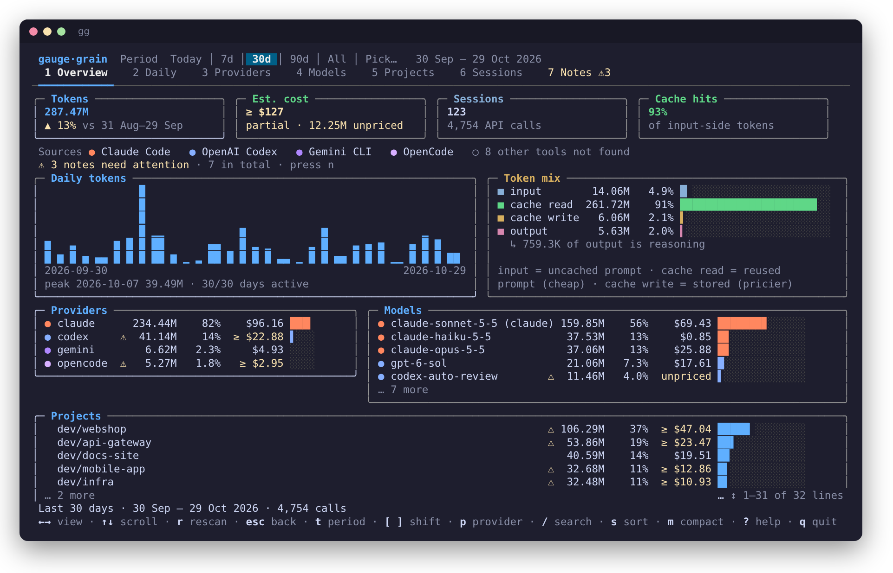
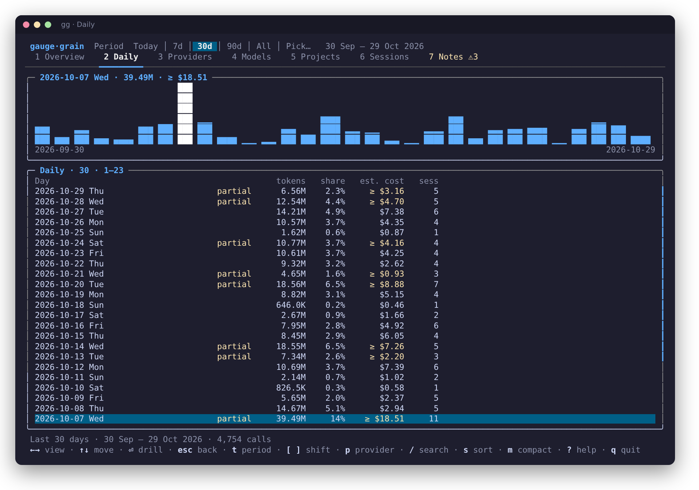
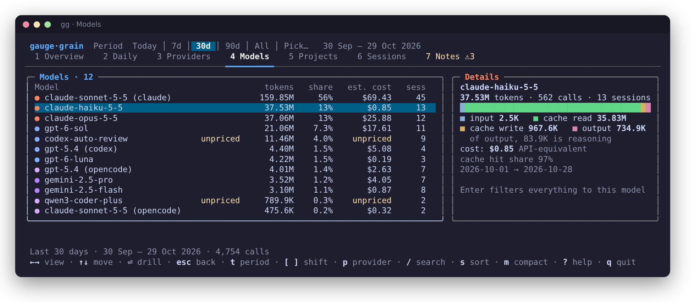

<h1 align="center">Gauge &amp; Grain</h1>

<p align="center"><b>Where does your AI coding usage go?</b><br>
One local, honest view of your tokens and estimated cost across Claude Code, Codex and more —<br>
as a compact report or an interactive terminal dashboard. Run it with <code>gg</code>.</p>

<p align="center"></p>
<p align="center"><sub>Screenshots use synthetic demo data (<code>scripts/demodata</code>), not anyone's real logs.</sub></p>

- **Local only** — reads the logs your tools already write; nothing is uploaded, no HTTP client in the binary.
- **Honest numbers** — unknown models are *unpriced*, unreported fields are *n/a*, never a silent `0`; cost is labelled an estimate.
- **Counted once** — streamed chunks, resumed sessions, archived copies and Codex re-broadcasts are de-duplicated.
- **Fast** — incremental cache; a filter or period change on 270k API calls takes ~2 ms.

## Install

```sh
curl -fsSL https://raw.githubusercontent.com/MarcZX10/gauge-and-grain/main/scripts/install.sh | sh   # Linux / macOS
irm https://raw.githubusercontent.com/MarcZX10/gauge-and-grain/main/scripts/install.ps1 | iex          # Windows
go install github.com/MarcZX10/gauge-and-grain/cmd/gg@latest                                           # any OS with Go 1.26+
```

Update by running the same command again. The installers verify a SHA-256 checksum, and the release signature when
`cosign` is installed; [how to check a download](docs/PRIVACY.md#verify-a-download).

## Use

```sh
gg                          # dashboard on a terminal, report when piped
gg report --compact         # a handful of lines: the headline numbers
gg report --days 7 --provider codex
gg export --format csv --by model > models.csv
gg notes                    # how far to trust the numbers
```

## A quick tour

**Daily** — the selected day lights up in the chart. Point at a bar to preview that day; click it to select it, and click again to drill into it.

<p align="center"></p>

**Models, projects, sessions** — ranked, with a details panel for the selected row.

<p align="center"></p>

<table>
<tr>
<td width="50%"><br><sub><b>Periods</b> — presets, <code>2026-10</code>, <code>14d</code>, ranges; <code>[</code> <code>]</code> move through time.</sub></td>
<td width="50%"><br><sub><b>Compact</b> — press <code>m</code>: only what matters.</sub></td>
</tr>
</table>

More: the **Notes** view (every caveat in one place), narrow terminals and the report are in the [user guide](docs/GUIDE.md).

## Supported tools

| | |
|---|---|
| **Claude Code**, **OpenAI Codex** | verified against real logs |
| Gemini CLI · Qwen Code · Pi Agent · DeepSeek Harness · Cline · Roo Code · Kilo Code · Zoo Code · OpenCode · Kilo CLI | **experimental**: built from documented formats, flagged in the app until checked against real logs |
| Grok · Copilot (CLI, VS Code) · Antigravity · Piebald | not supported — [why](docs/PROVIDERS.md#not-supported-and-why) |

## What `gg` will not pretend

Cost is **API-equivalent at list prices, not your bill** · experimental parsers say so wherever their data
appears · exports use empty cells / `null`, never invented zeros · see [limitations](docs/LIMITATIONS.md).

## Documentation

| | |
|---|---|
| [**User guide**](docs/GUIDE.md) | every command, flag, key and mouse action; periods; compact mode; configuration |
| [What the numbers mean](docs/METRICS.md) | token definitions, cost, comparisons, previous periods |
| [Exports](docs/EXPORT.md) | JSON and CSV schemas, `jq` recipes |
| [Supported tools](docs/PROVIDERS.md) | data locations, parser assumptions, what is experimental and why |
| [Pricing](docs/PRICING.md) | sources, dates, overriding prices |
| [Privacy & security](docs/PRIVACY.md) | what is read, kept and never sent; untrusted logs |
| [FAQ & troubleshooting](docs/FAQ.md) | "no data", "unpriced", "doesn't match my bill"… |
| [Limitations](docs/LIMITATIONS.md) | everything it cannot do or derive |
| [Architecture](docs/ARCHITECTURE.md) · [Contributing](docs/CONTRIBUTING.md) | design, tests, adding a tool, regenerating screenshots |

## Licence

MIT — see [LICENSE](LICENSE). Formats of the experimental tools were cross-checked against
[splitrail](https://github.com/Piebald-AI/splitrail)'s open-source analyzers (MIT); no code was copied.
