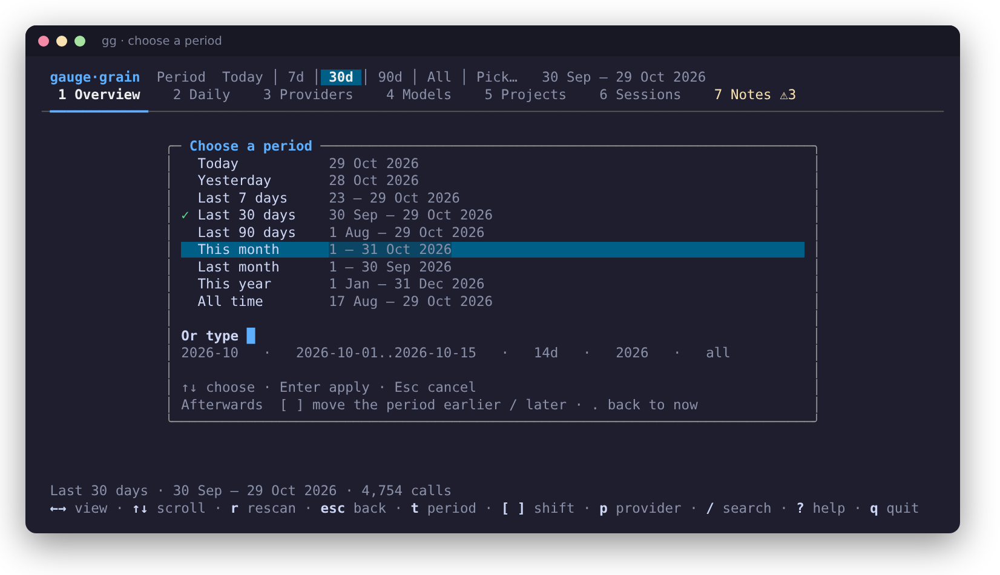
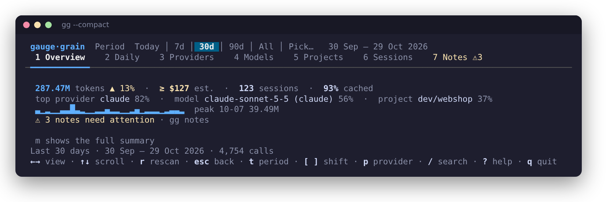
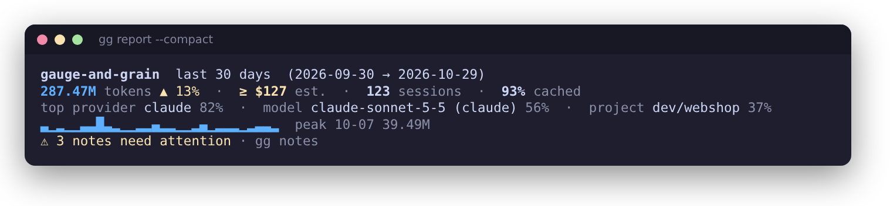
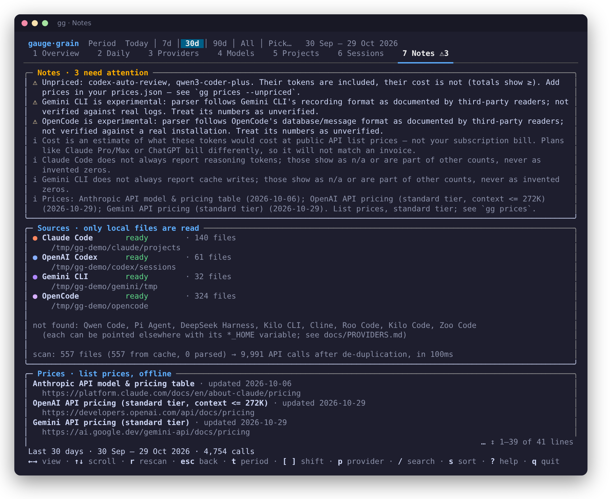
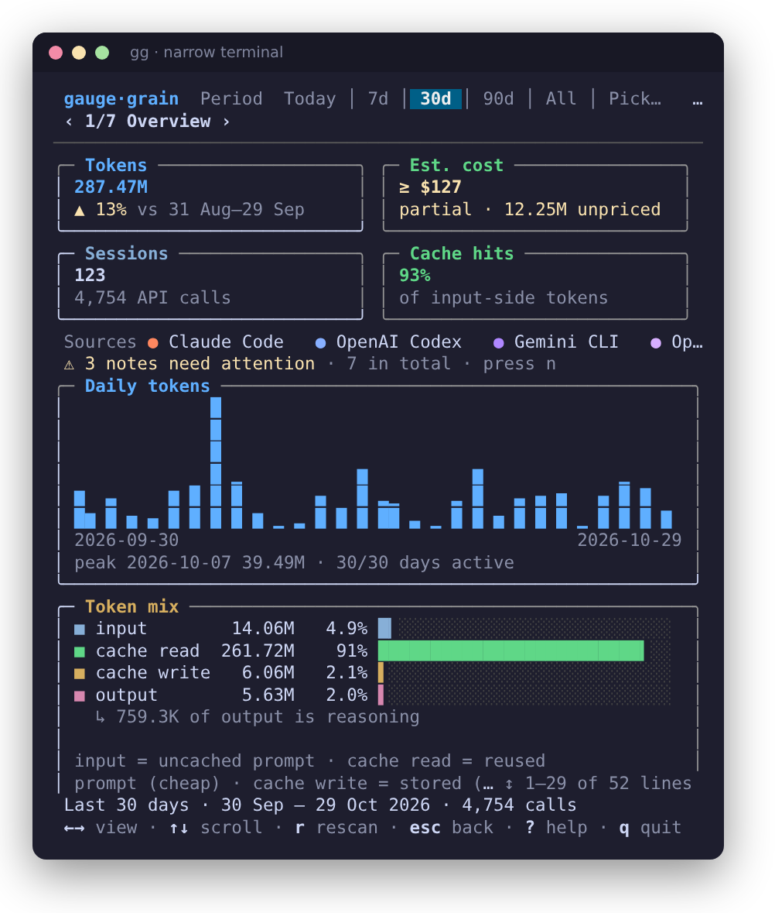

# User guide

Everything `gg` can do, in one place. For the short version see the [README](../README.md).

- [Commands](#commands)
- [Filters](#filters)
- [Periods](#periods)
- [The dashboard (TUI)](#the-dashboard-tui)
- [Compact mode](#compact-mode)
- [The report](#the-report)
- [Notes](#notes)
- [Configuration](#configuration)
- [Colour, plain output and small terminals](#colour-plain-output-and-small-terminals)
- [Cancelling and the cache](#cancelling-and-the-cache)

## Commands

| Command | What it does |
|---|---|
| `gg` | Opens the dashboard when stdout and stdin are terminals; prints the report otherwise (so `gg \| less` and scripts get text). |
| `gg report` | The compact text report. Add `--compact`, `--daily`, `--notes`. |
| `gg tui` | Forces the dashboard. |
| `gg notes` | How far to trust the numbers: estimates, unpriced models, gaps, experimental data, sources, price dates. |
| `gg export` | JSON or CSV to stdout. See [EXPORT.md](EXPORT.md). |
| `gg sources` | Which tools were found on this machine, where, how many files, and what is missing and why. |
| `gg prices` | The price table with sources and dates. `--unpriced` also scans your history for models with no price. |
| `gg cache clear` | Deletes the incremental cache (it is rebuilt on the next run). |
| `gg version` · `gg help` | |

Exit status: `0` on success, `1` on an error (bad flag, unreadable prices file…), `130` when a report scan was
cancelled with Ctrl-C (the partial report is still printed and marked as partial).

## Filters

Accepted by `report`, `tui`, `notes` and `export`:

| Flag | Meaning |
|---|---|
| `--days N` | The last N days **including today**. Default `30`. |
| `--from DATE` `--to DATE` | A date range, `YYYY-MM-DD`, local time. `--to` is inclusive. Either may be omitted. |
| `--all` | The whole history. |
| `--provider ID` | One or more of `claude codex gemini qwen pi deepseek opencode kilocli cline roo kilo zoo`. Repeat the flag or comma-separate. |
| `--model TEXT` | The model name contains `TEXT` (case-insensitive). Repeatable. |
| `--project TEXT` | The project path contains `TEXT` (case-insensitive). Repeatable. |

Date filters work in **whole days in your local time zone**. A model or project filter that matches nothing
produces an empty (not an error) result.

```sh
gg report --provider claude,codex --days 14
gg report --model opus --from 2026-10-01 --to 2026-10-15
gg export --project my-app --format csv --by session
```

## Periods

In the dashboard the time range is a **period**. The header always shows the active period and its exact dates:

```
Period  Today │ 7d │ [30d] │ 90d │ All │ Pick…   30 Sep – 29 Oct 2026
```

- **Quick periods** — click a chip, or press `d` / `D` to step through *Today · 7d · 30d · 90d · All*.
- **Picker** — press `t` (or click `Pick…`). Choose *Today, Yesterday, Last 7 / 30 / 90 days, This month, Last month,
  This year, All time*, each listed with its exact dates, or **type** one:

  | Type | Meaning |
  |---|---|
  | `14d` or `14 days` | the last 14 days |
  | `2026-10-29` | that day |
  | `2026-10` | that month |
  | `2026` | that year |
  | `2026-10-01..2026-10-15` (or `A B`, `A to B`) | an inclusive range |
  | `all` | everything |

- **Moving through time** — `[` shifts the period **earlier by its own length** (30d → the 30 days before; a month →
  the previous month; a custom range → an equal range before it), `]` shifts it later (never into the future), `.`
  returns to now. A shifted period is marked (`30d ◂1`).
- **Comparison** — the cards say what they are compared with (`▲ 12% vs 31 Aug–29 Sep`). Rolling periods compare
  with the window of equal length just before; calendar periods (this month, this year) compare with the previous
  *calendar* period.

On the command line the equivalent is `--days`, `--from/--to` and `--all`.

<p align="center"></p>

## The dashboard (TUI)

`gg` opens a dashboard with seven views:

| View | Key | What it shows |
|---|---|---|
| Overview | `1` · `o` | Cards (tokens, estimated cost, sessions, cache hits) with change vs the previous period; daily chart; token mix; top providers, models, projects. |
| Daily | `2` | An activity calendar (one column per week, shaded by the busiest day; on terminals at least 30 rows tall), a bar chart with the selected day highlighted, and a table of every day. |
| Providers | `3` | Ranked, with a details panel. |
| Models | `4` | Same, with `unpriced` / `partial` flags. A model name reported by two tools shows as `gpt-5.4 (codex)` / `gpt-5.4 (opencode)`. |
| Projects | `5` | Working directory of each session. |
| Sessions | `6` | The heaviest sessions. |
| Tools | `7` | Tools and skills the assistant called, from Claude Code transcripts (see below). |
| Notes | `8` · `n` | Every caveat, plus sources and prices. A `⚠N` badge appears when something needs attention. |

Providers keep one colour everywhere (Claude orange, Codex blue, Gemini purple…). **Yellow always means caution**
(an estimate, an unpriced model, partial data). Each list has a **details panel** for the selected row: composition of
tokens, cost, cache hit share, first/last seen.

### Keys

| Key | Action |
|---|---|
| `←` `→` · `Tab` `Shift+Tab` · `h` `l` · `1`–`8` | switch view |
| `↑` `↓` · `j` `k` · `PgUp` `PgDn` · `g` `G` | move / scroll |
| `Enter` | **drill in**: filter everything to the selected day, provider, model (and its provider when the name is shared) or project. On Sessions, Enter says there is nothing finer. |
| `Esc` · `Backspace` | undo the last drill-down → clear the search → back to Overview |
| `t` · `d` `D` · `[` `]` `.` | periods — see above |
| `p` | cycle the provider filter (this replaces a provider given with `--provider`) |
| `/` | search model, project or session text (`Enter` applies, `Esc` cancels) |
| `s` | sort by tokens or by estimated cost (applies to Providers, Models, Projects and Sessions) |
| `m` | toggle [compact mode](#compact-mode) |
| `e` | export the table you are on (Daily to Sessions) to a CSV file, `gg-<table>-<time>.csv`, in the folder you started `gg` from. Overview, Notes and Tools have no table: `e` writes nothing there. |
| `c` | clear every filter, including the ones given on the command line |
| `r` · `R` | rescan now (unchanged files are not re-read). `Esc` stops a rescan that runs in the background. |
| `?` | help · `q` or `Ctrl-C` quit (`q` also quits from the help screen) |

Active filters appear as chips at the right of the header, so you always know why the numbers are what they are.
On a narrow terminal the chips become a count (`2 filters`) and the status line names them. The Notes warning badge
stays visible on a narrow terminal too.

**Tools** counts the tool calls each reply made in Claude Code and Codex transcripts (for example `Bash`, `Read`, or an MCP tool such
as `mcp__docs__guide`), and lists skills under `skill:<name>`. Each call is attributed to the reply that made it, so the
counts follow the same period and filters as everything else. The other tools are not read for tool calls yet.

While the first scan runs, `q` quits and `Esc` cancels the scan (finished files stay cached).

The dashboard is static after its initial scan by default. Start it with `gg --watch` (or `gg tui --watch`) to
rescan in the background every minute; `GG_REFRESH=<seconds>` changes the interval, and `0` disables automatic
rescans. The incremental cache keeps unchanged files out of each rescan. The view keeps its place, and the status
line shows `updating…` and the time of the last update. Press `r` for a manual rescan at any time.

### Mouse

Click a view tab, a period chip, `Pick…`, or a row (click the selected row again to drill in). The wheel scrolls.
While the period picker is open, the mouse only chooses from it: click one of its lines to apply that period.

On **Daily**, the selected day is drawn in its own colour in the chart. **Pointing at a bar or a row previews that
day** (the chart follows the pointer) but does not change the selection: click a bar to select it, and click it again
to drill into that day. Enter always acts on the keyboard selection.

The dashboard enables mouse reporting, so the terminal does not select text on a plain drag. Hold **Shift** while you
drag to select and copy text (on most terminals; over SSH or tmux the multiplexer may need its own setting).

## Compact mode

For when you only want the headline: tokens and estimated cost with their change vs the previous period, sessions,
cache share, the top provider / model / project, a one-line trend with the peak day, and a warning **only** if
something needs attention.

```
287.47M tokens ▲ 13%  ·  ≥ $127 est.  ·  123 sessions  ·  93% cached
top provider claude 82%  ·  model claude-sonnet-5-5 56%  ·  project dev/webshop 37%
▁▂▁▂▁▁█▃▂▁▁▂▂▄▂▂▁▁▂▄▁▂▂▂▁▂▃▃▂  peak 10-07 39.49M
⚠ 3 notes need attention · gg notes
```

| How | Effect |
|---|---|
| `m` in the dashboard | toggles the compact Overview (from any view it jumps to the Overview) |
| `gg tui --compact` | starts compact |
| `gg report --compact` · `-c` | prints just these lines |
| `GG_COMPACT=1` | makes compact the default for both |

<p align="center"></p>
<p align="center"></p>

## The report

`gg report` prints the same data without a UI: headline numbers, token mix, a daily trend, and the top providers,
models and projects. `--daily` adds a per-day table; `--notes` appends the full [notes](#notes). Width follows your
terminal (`COLUMNS` if it is not a terminal) and never overflows. When stdout is a pipe the output is plain text.

## Notes

The caveats are data, not decoration, and they are in one place: the `Notes` view, `gg notes`, and `report --notes`.
They are generated from what is actually in your totals: the "estimate, not a bill" caveat, **unpriced models**,
**experimental** providers whose data is included, tools found but not parsed, unreadable files, a cancelled (partial)
scan, per-provider fields that are not always reported, malformed/duplicate record counts, and the source and date of
every price. Warnings come first.

<p align="center"></p>

## Configuration

| What | How |
|---|---|
| Price overrides | `<config dir>/gauge-and-grain/prices.json`, or `--prices FILE` — see [PRICING.md](PRICING.md) |
| Cache | `<cache dir>/gauge-and-grain/`; `--no-cache` ignores it; `gg cache clear` deletes it |
| Where tools keep their data | `CLAUDE_CONFIG_DIR`, `CODEX_HOME`, `GEMINI_HOME`, `QWEN_HOME`, `PI_HOME`, `OPENCODE_HOME`, `KILO_HOME`, `DSH_HOME`, `XDG_DATA_HOME`; `GG_VSCODE_USER_DIRS` (developer and test override) replaces the editor search for Cline/Roo/Kilo/Zoo — see [PROVIDERS.md](PROVIDERS.md) |
| Dashboard memory | `<config dir>/gauge-and-grain/tui.json` keeps the sort, the view, the period preset and compact mode between runs. A period given on the command line always wins. Delete the file to forget them. |
| Background rescan | `--watch` enables it (default off); interval defaults to `60` seconds and can be set with `GG_REFRESH=<seconds>` (`0` disables it) |
| Compact by default | `GG_COMPACT=1` |
| Test/dev overrides | `GG_CONFIG_DIR`, `GG_CACHE_DIR` |

`<config dir>` and `<cache dir>` are the OS defaults: `~/.config` and `~/.cache` on Linux, `~/Library/Application
Support` and `~/Library/Caches` on macOS, `%AppData%` and `%LocalAppData%` on Windows. `gg sources` prints the exact
paths in use.

## Colour, plain output and small terminals

- Colour is on only for a terminal. `--no-color` (alias `--plain`), `NO_COLOR`, or `TERM=dumb` turn it off;
  `FORCE_COLOR=1` turns it on for a pipe.
- `--ascii` (or a non-UTF-8 locale such as `LANG=C`) replaces bars, arrows and borders with ASCII.
- The dashboard needs at least **40×8**; below that it asks for a bigger window instead of drawing garbage. As the
  terminal narrows it drops columns, shortens tab names, hides the details panel and finally shows one tab at a time.
  Resizing is live.

<p align="center"></p>

After an upgrade that changes how a tool's logs are read, the dashboard does not wait for every log to be read again.
It shows the usage from the cache of the previous version at once (for logs that have not changed, or whose beginning
has not), says so in the status line (`N files updating from the previous version`), and reads those logs again in the
background. Numbers can move a little when the update finishes. The command-line report reads everything before it
prints, as always.

## Cancelling and the cache

The first scan of a large history can take a while: the dashboard shows a progress panel, the report shows a meter on
stderr. **`Esc` (dashboard, while it scans) or `Ctrl-C` (report) cancels cleanly**: the files already read stay cached, what was read
so far is shown and clearly marked **PARTIAL**, and the next run resumes where it stopped. Later runs read only what
changed; a log that has only grown (an active session) is resumed from the last complete line instead of re-read.
